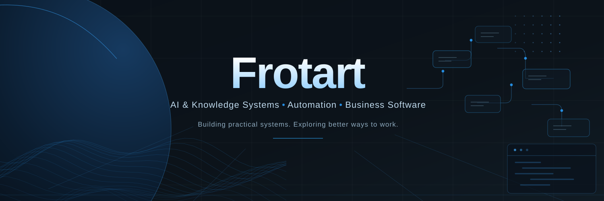

  

### About me

I'm interested in making technology genuinely useful — connecting software, AI, and automation to solve practical problems.

I enjoy exploring new tools, improving existing workflows, and building systems that are reliable, maintainable, and adaptable.

### What I'm exploring

- **AI & Knowledge Systems** — Portable knowledge, continuity, and AI-assisted workflows.
- **Automation** — Reducing repetitive work through thoughtful system design.
- **Business Software** — Improving everyday operational processes with practical tools.
- **Infrastructure** — Experimenting with Docker, Linux, self-hosting, and connected systems.

### Tools & Technologies

  
  
  
  
  
  

### My approach

> Build for usefulness. Question assumptions. Document decisions. Keep improving.

I value open-source technology, experimentation, and systems that remain understandable and maintainable.

### Featured Project

**[Folder Change Auditor](https://github.com/Frotart/folder-change-auditor)** · Python · MIT License

An offline, standard-library Python utility that compares SHA-256 folder snapshots to identify added, removed, and modified files. Includes synthetic demonstrations, a documented test suite, and cross-platform CI.

[Explore the code](https://github.com/Frotart/folder-change-auditor) · [Testing and limitations](https://github.com/Frotart/folder-change-auditor/blob/main/TESTING.md)

Most of my other projects remain in private development. I'll publish selected tools and documentation when they're ready.

---

*Always learning. Always refining.*
